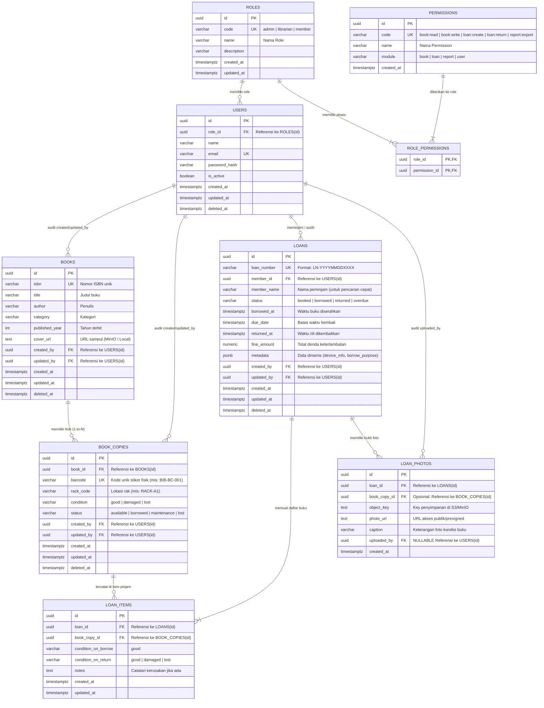
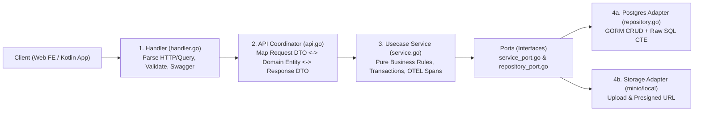

# Master PRD, ERD, & Agent Blueprint: Biblio (`biblio` Backend — The 80/20 `checker-backend` Clone)

> [!IMPORTANT]
> **Cara Menggunakan Dokumen Ini:**
> Dokumen ini adalah **Single Source of Truth (Konstitusi Utama)** di `.agents/rules/PRD_BACKEND_MASTER.md`. Setiap kali kita ngoding, AI Agent wajib menjadikan dokumen ini sebagai filter keputusan arsitektur, skema database, dan aturan bisnis agar tidak keluar jalur (*anti-halu*).

---

## 1. Identitas Produk, Visi 80/20, & Aturan Bisnis (Product Guardrails)

| Informasi Produk | Detail |
| :--- | :--- |
| **Nama Produk** | **Biblio** — Smart Library & Physical Book Tracking System |
| **Nama Go Module** | `biblio` |
| **Platform Target** | RESTful API Backend (Siap dikonsumsi Web Dashboard & Aplikasi Mobile Kotlin) |
| **Filosofi 80/20** | Menguasai **80% kekuatan arsitektur enterprise `checker-backend` (WMS)** melalui **20% skala domain bisnis perpustakaan**. |

### 1.1 Manajemen Akses Berbasis RBAC Tepat Guna (Pragmatic RBAC)
Alih-alih menggunakan hardcoded enum `role` di tabel `users`, **Biblio** menggunakan skema **RBAC (Role-Based Access Control) Tepat Guna**:
- Setiap User memiliki `role_id` yang mengacu ke tabel **`roles`** (contoh: `admin`, `librarian`, `member`).
- Setiap Role memiliki kumpulan izin aksi di tabel **`permissions`** melalui tabel penghubung **`role_permissions`** (contoh kode permission: `book:read`, `book:write`, `loan:create`, `loan:return`, `report:export`, `user:manage`).
- Endpoint diamankan menggunakan middleware berbasis permission (misal: `RequirePermission("book:write")`), bukan mengecek nama role secara hardcoded di handler.
- Selain pengguna manusia, terdapat **System Robot (Cron Job)** yang terautentikasi via `X-API-Key` untuk mengecek pinjaman yang melewati `due_date`.

### 1.2 Aturan Bisnis Keras (Core Business Guardrails — WAJIB DITEGAKKAN)
1. **Aturan Ketersediaan Fisik**: Buku fisik (`book_copies`) yang statusnya sedang `borrowed`, `maintenance`, atau `lost` **dilarang keras** untuk dipinjam.
2. **Aturan Transaksi Utuh (*All-or-Nothing* / Atomic)**: Jika seorang anggota meminjam beberapa buku sekaligus dan salah satu buku ternyata tidak tersedia, maka **seluruh transaksi peminjaman harus dibatalkan otomatis (`db.Transaction` Rollback)**.
3. **Aturan Urutan Status (*State Machine*)**:
   - Status pinjaman (`loans`) hanya boleh bergerak maju: `booked` $\rightarrow$ `borrowed` $\rightarrow$ `returned` (atau `borrowed` $\rightarrow$ `overdue` $\rightarrow$ `returned`).
   - Pinjaman yang sudah berstatus `returned` **tidak boleh** diubah kembali menjadi `borrowed` atau `booked`.
4. **Aturan Jejak Audit (*Audit Trail*)**: Setiap pembuatan atau perubahan data wajib mencatat siapa petugas yang melakukannya (`created_by`, `updated_by`) berdasarkan token login.

### 1.3 Batasan Masalah (Out of Scope — Dilarang Dibuat Tanpa Revisi PRD)
1. Pembayaran denda online (Payment Gateway / QRIS) — denda hanya dihitung nominalnya saja.
2. Fitur membaca buku digital (E-Book / PDF Reader) — fokus murni pada pelacakan buku fisik ber-barcode.
3. Sistem booking antrean jika buku sedang habis dipinjam.

### 1.4 Peta Analogi Domain (`checker-backend` $\leftrightarrow$ `Biblio`)

| Fitur di `checker-backend` (WMS) | Ekuivalen di `Biblio` (Library System) | Teknologi yang Dipelajari |
| :--- | :--- | :--- |
| **ASN / Delivery Order (DO)** | **Loan Transaction (`loans`)** — Transaksi peminjaman dengan siklus status: `booked` $\rightarrow$ `borrowed` $\rightarrow$ `returned` / `overdue`. | State Machine, Database Transaction (`db.Transaction`), Audit Trail (`created_by`, `updated_by`). |
| **Item & Pallet Barcode (`asn_item_rcs`)** | **Book (`books`) & Physical Copy (`book_copies`)** — Satu judul buku punya banyak eksemplar fisik dengan `barcode` unik, lokasi rak (`RACK-A1`), dan kondisi (`good`, `damaged`, `lost`). | Relasi `1-to-N`, JSONB `metadata`, Unique Constraint & Soft Delete (`deleted_at`). |
| **Admin List & SOH Query** | **Loan Admin List & Book Availability Summary** — Filter dinamis, pencarian `ILIKE`, *dynamic sorting*, dan kalkulasi stok tersedia vs sedang dipinjam. | **Hybrid GORM + Raw SQL** (`CTE`, `COALESCE`, `EXISTS`, `COUNT DISTINCT`, Parameterized `$1`). |
| **Upload Surat Jalan & Photo Log** | **Book Cover & Return Condition Photo (`loan_photos`)** — Upload foto sampul buku & bukti kondisi buku saat dikembalikan. | **MinIO / S3 Client (`minio-go/v7`)** dengan *Local Disk Fallback* (`MINIO_ENABLED=false`). |
| **Tally Sheet PDF & SOH Excel Export** | **Kartu Pinjam / Struk Peminjaman PDF & Export Laporan Buku Excel**. | `go-pdf/fpdf` (PDF Builder) & `xuri/excelize/v2` (Excel Generator). |
| **Live Dashboard & Scanner WebSocket** | **Real-Time Book Status & Loan Feed WebSocket**. | `gorilla/websocket`, In-Memory Hub / Postgres `LISTEN/NOTIFY`. |
| **Cron SOH Archive (`/cron/...`)** | **Automated Overdue & Fine Calculator (`/api/v1/cron/evaluate-overdue`)**. | `APIKeyMiddleware` (`X-API-Key`), Idempotent Batch Processing. |
| **OTEL Tracing & Structured Log** | **Tracing per Layer (`http` $\rightarrow$ `usecase` $\rightarrow$ `repo`) & JSON Logger**. | `log/slog`, `go.opentelemetry.io/otel`, `otelfiber`, `otelgorm`. |

---

## 2. Database Blueprint, ERD (Pragmatic RBAC), & State Machine



> [!NOTE]
> **Aturan Teknis Kolom Audit (`created_by`, `updated_by`, `uploaded_by`):**
> - Seluruh kolom audit wajib bersifat **`NULLABLE`** di PostgreSQL (`ON DELETE SET NULL`) dan menggunakan tipe pointer **`*uuid.UUID`** di struct Go.
> - Hal ini memungkinkan transaksi sistem otomatis (seperti Cron Job tengah malam) maupun operasi di Fase 1–2 berjalan lancar dengan nilai `NULL`, sekaligus tetap menjaga integritas Foreign Key ke `USERS(id)` saat diisi oleh petugas yang login.

---

## 3. Arsitektur Target (Hexagonal / Ports & Adapters)

Setiap modul domain (`book`, `loan`, `user`, `report`) **wajib** mengikuti struktur 4 lapis milik `checker-backend`:



### Struktur Direktori Target
```text
biblio/
├── cmd/
│   └── api/
│       └── main.go                      # Dependency Injection (Wiring semua modul) & Graceful Shutdown
├── docs/
│   └── swagger/                         # Auto-generated oleh `make swagger` (hanya docs.go yang di-commit)
├── internal/
│   ├── infrastructure/
│   │   ├── config/                      # Viper config loader (.env)
│   │   ├── server/                      # Fiber setup, CORS, Swagger registration, ErrorHandler
│   │   ├── database.go                  # GORM Postgres init + Connection Pool + Slow SQL logger
│   │   └── tracer.go                    # Global OpenTelemetry Tracer helper
│   ├── utils/
│   │   ├── logger/                      # slog JSON/Text logger
│   │   ├── response/                    # Standard API Response (Success, Error, Paginated)
│   │   ├── storage/                     # StorageService Interface (MinIO S3 + Local Fallback)
│   │   └── telemetry/                   # OTEL Provider setup & shutdown
│   ├── auth/
│   │   ├── core/entities/               # user.go, role.go, permission.go
│   │   └── adapters/primary/http/       # JWTMiddlewareWithSkip, RequirePermission & APIKeyMiddleware
│   ├── book/                            # Modul Master Buku & Copy Eksemplar
│   │   ├── core/
│   │   │   ├── entities/                # book.go, book_copy.go
│   │   │   └── usecases/                # book_service.go
│   │   ├── ports/                       # repository_port.go, service_port.go
│   │   └── adapters/
│   │       ├── primary/http/            # handler.go, api.go, dto.go, response_dto.go
│   │       └── secondary/postgres/      # repository.go
│   └── loan/                            # Modul Transaksi Peminjaman (Setara modul ASN/DO)
│       ├── core/
│       │   ├── entities/                # loan.go, loan_item.go
│       │   └── usecases/                # loan_service.go
│       ├── ports/                       # repository_port.go, service_port.go
│       └── adapters/
│           ├── primary/http/            # handler.go, api.go, dto.go, response_dto.go
│           ├── primary/websocket/       # ws_handler.go (Live feed peminjaman)
│           └── secondary/postgres/      # repository.go (Hybrid GORM + Raw SQL)
├── Makefile                             # Standarisasi command: make dev, swagger, test, build, lint
├── docker-compose.yml                   # Postgres + MinIO + Jaeger (OTEL UI)
└── .env.example
```

---

## 4. Rencana Tahapan Eksekusi (6 Fase / Sprint)

> [!TIP]
> **Aturan Belajar (Grinding Rule):** Jangan lanjut ke Fase berikutnya sebelum semua *Definition of Done (DoD)* pada Fase aktif terpenuhi, ditest via Swagger/Postman, dan kamu paham alur baris kodenya.

---

### Fase 1: Pondasi Infrastruktur, Makefile, & Refactor ke Hexagonal Architecture
**Tujuan Pembelajaran:** Memahami bagaimana `cmd/api/main.go` merakit aplikasi (*Manual Dependency Injection*), bagaimana `Makefile` mengotomasi workflow kerja, dan memisahkan kode yang tercampur menjadi *Handler $\rightarrow$ API $\rightarrow$ Usecase $\rightarrow$ Repository*.

#### Ruang Lingkup Kerja (Scope):
1. **Setup `Makefile` & `docker-compose.yml`**:
   - Buat `docker-compose.yml` berisi **PostgreSQL 16**.
   - Buat `Makefile` persis seperti `checker-backend` dengan target: `help`, `deps`, `swagger`, `dev`, `build`, `test`, `fmt`, `vet`, `clean`.
2. **Setup Infrastructure & Standard Response**:
   - Implementasi `internal/infrastructure/config` dengan `spf13/viper` membaca `.env`.
   - Implementasi `internal/infrastructure/database.go` menggunakan GORM Postgres dengan pengaturan `MaxIdleConns`, `MaxOpenConns`, dan `SlowThreshold: 200 * time.Millisecond`.
   - Implementasi `internal/utils/response` agar semua endpoint mengeluarkan struktur JSON seragam (penting untuk **Kotlin Serialization / Retrofit** nantinya):
     ```json
     {
       "status": "success",
       "message": "Books retrieved successfully",
       "data": { ... }
     }
     ```
3. **Refactor Modul `book` ke Hexagonal Architecture**:
   - Pecah kode lama menjadi `entities/book.go`, `ports/`, `usecases/book_service.go`, `adapters/secondary/postgres/repository.go`, dan `adapters/primary/http/` (`handler.go`, `api.go`, `dto.go`, `response_dto.go`).
   - Terapkan *Graceful Shutdown* di `cmd/api/main.go` (menangkap sinyal `SIGINT`/`SIGTERM` untuk menutup koneksi DB dengan aman).

#### Definition of Done (DoD) Fase 1:
- [ ] Menjalankan `make dev` otomatis men-generate Swagger di `docs/swagger` dan menyalakan server Fiber.
- [ ] CRUD Buku (`POST`, `GET`, `PUT`, `DELETE /api/v1/books`) berjalan lewat 4 layer penuh.
- [ ] Tidak ada lagi query database atau model GORM yang bocor ke `handler.go`.

---

### Fase 2: Hybrid GORM + Raw SQL, Transaksi Database, & JSONB Metadata
**Tujuan Pembelajaran:** Menguasai filosofi **GORM + Raw SQL**, manajemen transaksi (`db.Transaction`), penggunaan `json.RawMessage` untuk kolom `metadata`, serta query list kompleks dengan CTE & Dynamic Sorting seperti `GetAdminList` di `checker-backend`.

#### Ruang Lingkup Kerja (Scope):
1. **Entitas Transaksi Peminjaman (`loan` & `loan_items`)**:
   - Buat tabel `book_copies` (eksemplar fisik dengan `barcode`, `rack_code`, `status`: `available`, `borrowed`, `maintenance`).
   - Buat tabel `loans` (`loan_number` auto-prefix `LN-YYYYMMDDXXXX`, `member_name`, `status`: `booked`, `borrowed`, `returned`, `overdue`, serta kolom `metadata JSONB` untuk menyimpan catatan dinamis seperti `{"borrow_purpose": "thesis", "device_info": "Kotlin-App"}`).
   - Buat tabel `loan_items` (menghubungkan `loan_id` dengan `book_copy_id`, kondisi saat pinjam & kondisi saat kembali).
2. **Atomic Database Transaction (`db.Transaction`)**:
   - Saat *Create Loan* atau *Confirm Borrow (Scan Barcode)*:
     - Insert ke `loans` & `loan_items` menggunakan GORM.
     - Update status `book_copies` menjadi `borrowed`.
     - Jika salah satu buku sedang tidak `available`, **batalkan seluruh transaksi (Rollback)**.
3. **Raw SQL dengan CTE & Dynamic Filter (`GetAdminLoanList`)**:
   - Di `loan/adapters/secondary/postgres/repository.go`, tulis query menggunakan `r.db.WithContext(ctx).Raw(query, args...).Scan(&rows)` yang menerapkan:
     - **CTE (`WITH item_counts AS (...)`)** untuk menghitung total buku yang dipinjam di setiap transaksi.
     - **`COALESCE` & `EXISTS`** untuk memberi flag `has_damaged_book` (mirip `has_warning` BAPB di ASN).
     - **Dynamic Filtering & Sorting** (`search` ILIKE nomor pinjam/nama peminjam, filter `status`, rentang tanggal `borrowed_from` - `borrowed_to`, dan whitelist `sortColumnMap`).

#### Definition of Done (DoD) Fase 2:
- [ ] Endpoint `POST /api/v1/loans` berhasil menyimpan `metadata` bertipe `json.RawMessage` tanpa *breaking change* bila dikosongkan.
- [ ] Endpoint `GET /api/v1/admin/loans` mampu memfilter, mengurutkan, dan melakukan paginasi menggunakan Raw SQL CTE dengan waktu eksekusi `< 50ms`.
- [ ] Simulasi gagal di tengah transaksi terbukti melakukan *Rollback* penuh di PostgreSQL.

---

### Fase 3: Security Layer (JWT Auth, Pragmatic RBAC, & Cron API Key)
**Tujuan Pembelajaran:** Memahami bagaimana mengamankan endpoint menggunakan JWT Middleware dengan `skipPaths`, RBAC berbasis `permissions` (`RequirePermission`), mengekstrak identitas user dari Fiber Context (`GetUserFromContext`), serta mengamankan endpoint internal/cron dengan `X-API-Key`.

#### Ruang Lingkup Kerja (Scope):
1. **Modul `auth` & Pragmatic RBAC (`roles`, `permissions`, `role_permissions`, `users`)**:
   - Buat tabel `roles`, `permissions`, `role_permissions`, dan `users` (dengan seeder default untuk role `admin`, `librarian`, `member` beserta permissions-nya).
   - Buat endpoint `POST /api/v1/auth/login` yang memverifikasi bcrypt password dan menerbitkan JWT (`golang-jwt/jwt/v5`) berisi `user_id`, `email`, `role_code`, dan daftar `permissions` (`[]string`).
2. **Custom JWT & RBAC Permission Middleware**:
   - Buat `JWTMiddlewareWithSkip` di `internal/auth/adapters/primary/http/middleware.go` yang memvalidasi header `Authorization: Bearer <token>`.
   - Buat `RequirePermission(permCode string)` middleware untuk mengecek apakah daftar permission di klaim JWT user memiliki izin yang diminta endpoint tersebut.
   - Sediakan helper `authmiddleware.GetUserFromContext(c)` untuk mengambil `UserID` di setiap handler (untuk mengisi kolom `created_by` dan `updated_by` secara otomatis!).
3. **Cron Endpoint dengan `APIKeyMiddleware`**:
   - Buat middleware yang memeriksa header `X-API-Key` terhadap `CRON_API_KEY` di `.env`.
   - Buat endpoint `POST /api/v1/cron/evaluate-overdue` yang otomatis mengubah status pinjaman yang melewati `due_date` menjadi `overdue`.

#### Definition of Done (DoD) Fase 3:
- [ ] Tombol **Authorize (Gembok)** di Swagger UI berfungsi dengan memasukkan `Bearer <token>`.
- [ ] User dengan role yang tidak memiliki permission `book:write` otomatis ditolak dengan `403 Forbidden` saat mencoba menambah/menghapus buku.
- [ ] Setiap pembuatan buku/peminjaman otomatis mencatat UUID user dari JWT ke kolom `created_by`.
- [ ] Endpoint `/api/v1/cron/evaluate-overdue` menolak akses tanpa `X-API-Key` yang valid.

---

### Fase 4: Object Storage S3 / MinIO dengan Local Fallback (`make s3`)
**Tujuan Pembelajaran:** Menguasai arsitektur `internal/utils/storage` di `checker-backend`—bagaimana aplikasi mengunggah file (`multipart/form-data`), mengompresi/memvalidasi gambar, menyimpannya ke **MinIO (S3-compatible)**, atau otomatis beralih ke folder lokal jika `MINIO_ENABLED=false`.

#### Ruang Lingkup Kerja (Scope):
1. **Tambahkan MinIO ke `docker-compose.yml` & `Makefile`**:
   - Tambahkan container `minio/minio` di `docker-compose.yml` (Port `9000` untuk API S3, Port `9001` untuk Web Console).
   - Tambahkan target `make s3-up` dan `make s3-init` di `Makefile` untuk menyalakan dan menyiapkan bucket `biblio-photos`.
2. **Implementasi `StorageService` Interface**:
   - Buat kontrak interface di `internal/utils/storage/storage.go`:
     ```go
     type StorageService interface {
         UploadFile(ctx context.Context, file multipart.File, header *multipart.FileHeader, folder string) (string, error)
         DeleteFile(ctx context.Context, objectKey string) error
         GetPublicURL(objectKey string) string
     }
     ```
   - Buat 2 implementasi: `MinioStorage` (menggunakan `github.com/minio/minio-go/v7`) dan `LocalStorage` (menyimpan ke `./uploads/`). Pilih secara dinamis di `main.go` berdasarkan env `MINIO_ENABLED`.
3. **Endpoint Upload Sampul Buku & Bukti Pengembalian**:
   - `POST /api/v1/books/:id/cover`: Upload gambar sampul buku.
   - `POST /api/v1/loans/:id/return-photo`: Upload foto kondisi fisik buku saat dikembalikan oleh peminjam (persis seperti `asn_photo_log` / `UploadSuratJalan`).

#### Definition of Done (DoD) Fase 4:
- [ ] Saat `MINIO_ENABLED=false`, upload gambar tersimpan di folder lokal dan bisa diakses via URL statis.
- [ ] Saat `MINIO_ENABLED=true`, upload gambar langsung masuk ke bucket MinIO dan mengembalikan URL publik/presigned yang valid.

---

### Fase 5: Observability (OpenTelemetry Tracing & `slog`) + Unit Testing
**Tujuan Pembelajaran:** Memahami mengapa di setiap fungsi `checker-backend` selalu diawali dengan `ctx, span := infrastructure.Tracer().Start(ctx, "...")` dan `slog.ErrorContext(...)`, serta bagaimana memvisualisasikan jejak request (*Flamegraph*) dari HTTP hingga query SQL di Jaeger UI.

#### Ruang Lingkup Kerja (Scope):
1. **Structured Logging (`log/slog`)**:
   - Ganti semua `fmt.Println` / `log.Printf` dengan `slog.InfoContext` dan `slog.ErrorContext` yang menyertakan atribut terstruktur (`slog.String("loan_id", id.String())`).
2. **OpenTelemetry Tracing End-to-End**:
   - Tambahkan container `jaegertracing/all-in-one` di `docker-compose.yml` (menerima OTLP di port `4317`, UI di `http://localhost:16686`).
   - Pasang middleware `otelfiber` di Fiber dan plugin `otelgorm` di GORM.
   - Tambahkan manual span di setiap layer:
     - `http:loan:Create` (di `api.go`)
     - `usecase:loan:Create` (di `service.go`)
     - `repo:loan:Create` (di `repository.go`)
3. **Unit Testing & Mocking (`stretchr/testify`)**:
   - Buat unit test untuk `loan_service_test.go` dan `api_test.go` untuk menguji skenario sukses dan gagal tanpa harus menyentuh database asli (atau menggunakan test DB).

#### Definition of Done (DoD) Fase 5:
- [ ] Saat menembak 1 endpoint API, di Jaeger UI (`localhost:16686`) terlihat pohon trace lengkap dari HTTP $\rightarrow$ API $\rightarrow$ Usecase $\rightarrow$ GORM SQL query beserta durasi milidetik tiap tahap.
- [ ] `make test` berjalan hijau (PASS) dengan laporan coverage (`make test-coverage`).

---

### Fase 6: Reporting (PDF & Excel), Real-Time WebSocket, & Kotlin Client Contract
**Tujuan Pembelajaran:** Melengkapi kepingan terakhir `checker-backend`: generate dokumen cetak (PDF & Excel), notifikasi real-time via WebSocket, dan memastikan seluruh API siap diintegrasikan dengan aplikasi **Kotlin** & **Web Frontend**.

#### Ruang Lingkup Kerja (Scope):
1. **Document Generation (PDF & Excel)**:
   - **PDF (`go-pdf/fpdf`)**: Endpoint `GET /api/v1/loans/:id/receipt/pdf` untuk men-download **Struk Peminjaman / Tally Sheet Buku** lengkap dengan tabel daftar buku & kode barcode.
   - **Excel (`xuri/excelize/v2`)**: Endpoint `GET /api/v1/reports/loans/excel` untuk mengunduh laporan peminjaman bulanan dengan styling header & auto-width kolom.
2. **Real-Time WebSocket Feed**:
   - Buat WebSocket Hub di `internal/loan/adapters/primary/websocket/`.
   - Saat ada buku yang dipinjam atau dikembalikan (`POST /api/v1/loans/:id/return`), broadcast event JSON ke `/api/v1/loans/ws` sehingga layar Dashboard / aplikasi Kotlin langsung ter-update secara *real-time* tanpa refresh.
3. **Finalisasi Kontrak API untuk Kotlin & Web FE**:
   - Audit seluruh anotasi Swagger (`swaggertype`, `example`, enum status) dan jalankan `make swagger`.
   - Pastikan `swagger.json` bersih sehingga bisa langsung di-import ke Postman atau di-generate menjadi **Kotlin Data Classes / Retrofit Interface** menggunakan OpenAPI Generator.

#### Definition of Done (DoD) Fase 6:
- [ ] Endpoint PDF dan Excel menghasilkan file yang bisa langsung dibuka di pembaca PDF dan Microsoft Excel.
- [ ] Koneksi WebSocket menerima pesan broadcast secara instan saat status peminjaman berubah.
- [ ] Seluruh fitur `checker-backend` versi 20/80 telah berhasil kamu bangun sendiri dari nol hingga siap produksi!
