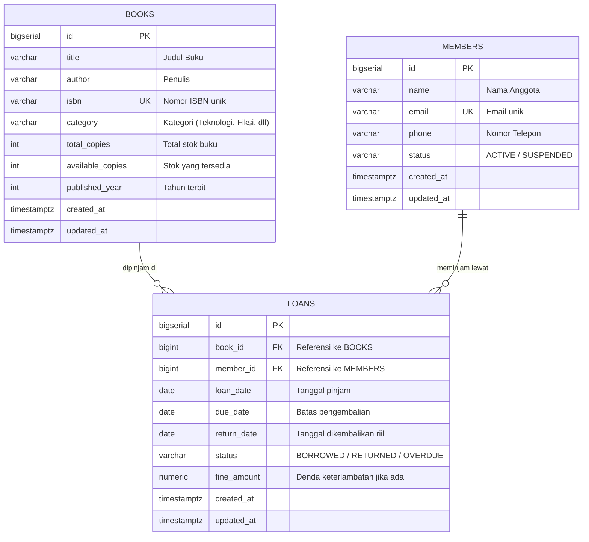
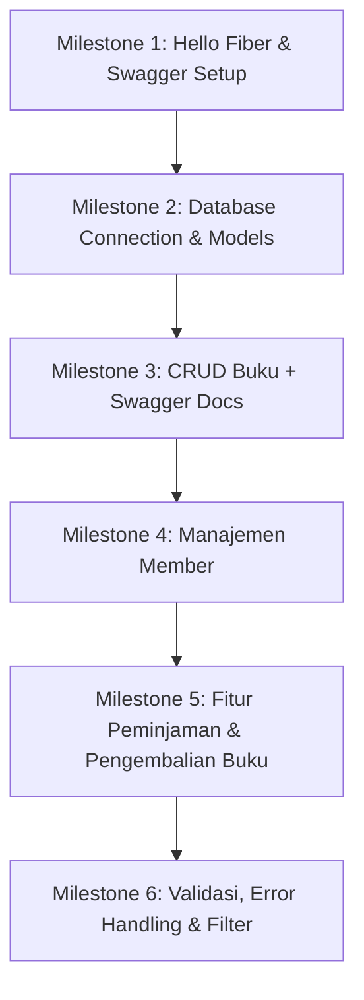

# 📚 Biblio API - Learning Roadmap & Guide

Selamat datang di project pembelajaran **Biblio API**! Dokumen ini dirancang sebagai panduan terstruktur untuk belajar membangun RESTful API menggunakan **Go (Golang)**, framework **Fiber v2**, dokumentasi interaktif **Swagger (swaggo)**, dan database **PostgreSQL di Docker**.

---

## 🎯 Tujuan Pembelajaran
1. **Go Idioms & Fundamentals**: Penggunaan struct, pointer, slice, error handling (`if err != nil`), interface, dan package management.
2. **Go Fiber Framework**: Routing, Context (`c.Ctx`), parsing request (Body, Query, Params), middleware, dan response handling.
3. **Swagger / OpenAPI**: Anotasi `swaggo`, generate file docs (`swag init`), dan menyajikan Swagger UI di Fiber.
4. **PostgreSQL & Docker**: Menjalankan Postgres via Docker, koneksi pool dari Go, schema migration, dan query relational.
5. **Clean Architecture (Layered)**: Memisahkan tanggung jawab antara `Handler` (HTTP), `Service` (Business Logic), dan `Repository` (Database).

---

## 🏗️ Arsitektur Proyek (Standard Go Layout)

Struktur folder yang direkomendasikan untuk memisahkan concern secara rapi:

```text
biblio/
├── cmd/
│   └── api/
│       └── main.go           # Entry point aplikasi
├── internal/
│   ├── config/               # Load konfigurasi & environment variables
│   │   └── database.go
│   ├── model/                # Struct domain / database entity & DTO
│   │   ├── book.go
│   │   ├── member.go
│   │   ├── loan.go
│   │   └── response.go       # Format response seragam
│   ├── repository/           # Akses langsung ke database (SQL / ORM)
│   │   ├── book_repository.go
│   │   └── loan_repository.go
│   ├── service/              # Aturan bisnis (validasi kuota, denda, dsb)
│   │   ├── book_service.go
│   │   └── loan_service.go
│   └── handler/              # HTTP Controller & anotasi Swagger
│       ├── book_handler.go
│       └── loan_handler.go
├── docs/                     # Auto-generated oleh `swag init` (jangan diedit manual)
│   ├── docs.go
│   ├── swagger.json
│   └── swagger.yaml
├── docker-compose.yml        # (Opsional) Docker setup PostgreSQL
├── go.mod
├── go.sum
└── BIBLIO_GUIDE.md           # Panduan ini
```

---

## 🗄️ Desain Basis Data (PostgreSQL)

### Diagram Relasi Entitas (ERD)



---

## 🐳 Setup PostgreSQL di Docker

Kamu bisa menjalankan PostgreSQL langsung via terminal menggunakan Docker CLI atau Docker Compose:

### Pilihan 1: Docker CLI Langsung
```bash
docker run -d \
  --name biblio-pg \
  -e POSTGRES_USER=postgres \
  -e POSTGRES_PASSWORD=postgres \
  -e POSTGRES_DB=minilib_db \
  -p 5432:5432 \
  postgres:16-alpine
```

### Pilihan 2: Docker Compose (`docker-compose.yml`)
```yaml
version: '3.8'
services:
  postgres:
    image: postgres:16-alpine
    container_name: biblio-pg
    restart: always
    environment:
      POSTGRES_USER: postgres
      POSTGRES_PASSWORD: postgres
      POSTGRES_DB: minilib_db
    ports:
      - "5432:5432"
    volumes:
      - pgdata:/var/lib/postgresql/data

volumes:
  pgdata:
```
*Jalankan dengan:* `docker compose up -d`

---

## 📝 Roadmap Pengerjaan Bertahap



### Milestone 1: Setup Dasar & Verifikasi Swagger UI
- [ ] Inisialisasi Fiber app sederhana di `cmd/api/main.go`.
- [ ] Buat 1 endpoint uji coba: `GET /health` (status check).
- [ ] Tambahkan komentar anotasi API umum (`@title`, `@version`, `@host`, `@BasePath`).
- [ ] Anotasi endpoint `/health` dengan tag Swagger (`@Summary`, `@Produce`, `@Success`, `@Router`).
- [ ] Install CLI tool `swag` (jika belum) dan jalankan `swag init -g cmd/api/main.go`.
- [ ] Buka browser di `http://localhost:3000/swagger/` untuk memastikan Swagger UI tampil.

### Milestone 2: Koneksi Database PostgreSQL
- [ ] Menentukan driver / ORM (Rekomendasi: `GORM` dengan driver `gorm.io/driver/postgres`, atau `pgx`).
- [ ] Buat file konfigurasi koneksi database.
- [ ] Definisikan struct Model Go (`Book`, `Member`, `Loan`).
- [ ] Buat mekanisme Auto-Migration schema tabel ke PostgreSQL.

### Milestone 3: Fitur Buku (CRUD Lengkap)
- [ ] `POST /api/v1/books` - Tambah buku baru (request body validation).
- [ ] `GET /api/v1/books` - Ambil daftar buku (support query search & category).
- [ ] `GET /api/v1/books/:id` - Ambil detail 1 buku berdasarkan ID.
- [ ] `PUT /api/v1/books/:id` - Update info buku.
- [ ] `DELETE /api/v1/books/:id` - Hapus buku.
- [ ] Beri anotasi Swagger pada setiap handler dan generate ulang `swag init`.

### Milestone 4: Fitur Anggota (Members)
- [ ] `POST /api/v1/members` - Registrasi anggota baru.
- [ ] `GET /api/v1/members` - List anggota perpustakaan.
- [ ] `GET /api/v1/members/:id` - Detail profil & status keanggotaan.
- [ ] `PATCH /api/v1/members/:id/status` - Suspend / aktifkan anggota.

### Milestone 5: Fitur Transaksi (Peminjaman & Pengembalian)
- [ ] `POST /api/v1/loans/borrow` - Peminjaman buku:
  - Cek apakah member aktif.
  - Cek apakah stok `available_copies > 0`.
  - Kurangi stok buku (`available_copies - 1`).
  - Buat record peminjaman dengan `due_date` (misal: 7 hari ke depan).
- [ ] `POST /api/v1/loans/return` - Pengembalian buku:
  - Cek record peminjaman.
  - Tambah stok buku kembali (`available_copies + 1`).
  - Hitung denda keterlambatan jika `return_date > due_date`.
  - Ubah status menjadi `RETURNED`.
- [ ] `GET /api/v1/loans/active` - List peminjaman yang sedang berjalan.

### Milestone 6: Polishing & Best Practices
- [ ] Standardisasi format response JSON `{ "status": "success", "data": ... }`.
- [ ] Centralized error handling di Fiber.
- [ ] Query parameter pagination (page, limit) & sorting.

---

## 💡 Cheatsheet Sintaks Swagger untuk Fiber

### 1. Anotasi Global (di `main.go`)
```go
// @title           Biblio API
// @version         1.0
// @description     RESTful API Pengelolaan Perpustakaan Mini menggunakan Go Fiber & PostgreSQL.
// @host            localhost:3000
// @BasePath        /
```

### 2. Anotasi Endpoint Handler (di handler)
```go
// GetBooks godoc
// @Summary      Ambil daftar buku
// @Description  Mengambil seluruh buku dengan filter opsional
// @Tags         Books
// @Accept       json
// @Produce      json
// @Param        title query string false "Cari judul buku"
// @Success      200 {object} model.WebResponse{data=[]model.Book}
// @Failure      500 {object} model.WebResponse
// @Router       /api/v1/books [get]
```

---

## 🤝 Aturan Kolaborasi Belajar Kita
1. **Kamu Menulis Kode**: Kamu yang mengetik kode manual di editor.
2. **AI sebagai Mentor**: AI akan menjelaskan logika, memberikan kerangka/hint, review kode, dan membimbing jika ada error.
3. **No Code Dump**: AI tidak akan memberikan solusi kode jadi instan tanpa kamu minta.
4. **No Direct Code File Editing**: AI tidak akan memodifikasi/membuat file `.go` di workspace tanpa instruksi langsung darimu.
